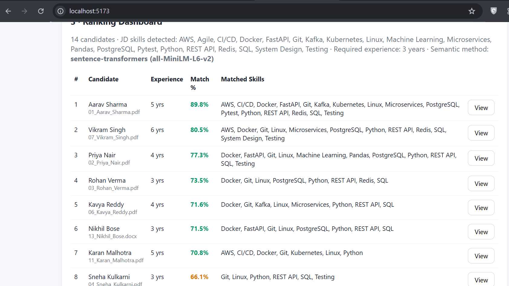
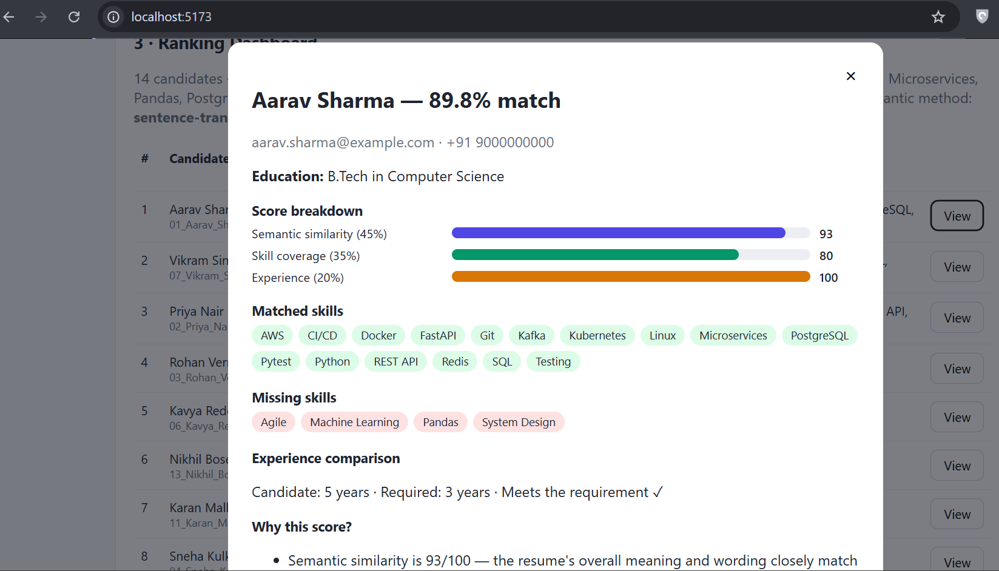
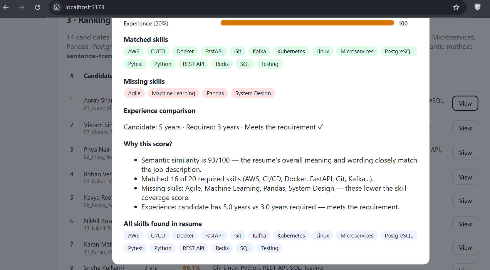
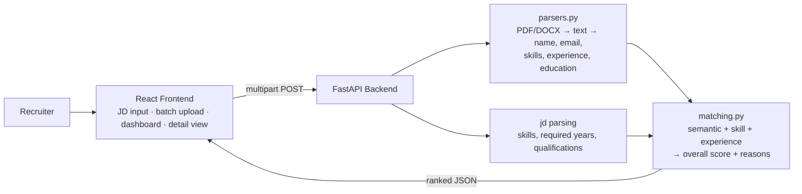

# AI-Based Resume Matching & Candidate Ranking System

A working prototype that compares multiple candidate resumes against a Job
Description (JD) and produces an **explainable match score (0–100)** for every
candidate, a **ranked dashboard**, and a **candidate-level breakdown** showing
matched skills, missing skills, experience comparison and the reasons behind
each score.

Built for an internship assignment. Uses **only synthetic sample data** — no
real candidate information.

---

## Screenshots

Ranking dashboard — 14 sample resumes ranked against the sample JD
(semantic method: sentence-transformers):



Candidate detail — score breakdown, matched and missing skills:



Score explanation — why this score, in plain words:



---

## Tech stack

| Layer | Choice |
|---|---|
| Frontend | React.js (Vite) |
| Backend | Python + FastAPI |
| Semantic AI | Sentence Transformers `all-MiniLM-L6-v2` **with automatic TF-IDF fallback** (scikit-learn) |
| Skill extraction | Curated skill taxonomy (80+ skills) in `backend/app/skills.py` |
| Parsing | PyMuPDF (PDF), python-docx (DOCX) |
| Storage | In-memory for the prototype (stateless API — see *Future improvements* for PostgreSQL/MongoDB) |

> **Why the fallback matters:** if the transformer model cannot be downloaded
> (offline machine, blocked network), the system automatically switches to
> TF-IDF cosine similarity and says so in the API response
> (`semantic_method` field) and on the dashboard. The demo never crashes.

## Architecture



## Folder structure

```
resume-matching-system/
├── backend/
│   ├── requirements.txt
│   └── app/
│       ├── main.py       # API endpoints (/api/health, /api/jd/analyze, /api/rank)
│       ├── parsers.py    # file→text, candidate/JD field extraction
│       ├── skills.py     # 80+ skill taxonomy + extraction
│       └── matching.py   # semantic similarity + scoring + reasons
├── frontend/
│   ├── index.html
│   ├── package.json
│   └── src/              # App.jsx (UI), main.jsx, styles.css
├── sample_data/
│   ├── generate_samples.py   # regenerates the demo data
│   ├── sample_jd.txt         # sample job description
│   └── resumes/              # 14 synthetic resumes (12 PDF + 2 DOCX)
├── docs/
│   ├── APPROACH.md       # technical approach & matching algorithm, in detail
│   └── screenshots/      # dashboard + candidate detail screenshots
└── TEST_RESULTS.md
```

## Setup & run

### 1. Backend (terminal 1)

```bash
cd backend
python3 -m venv .venv
source .venv/bin/activate        # Windows: .venv\Scripts\activate
pip install -r requirements.txt
uvicorn app.main:app --reload --port 8000
```

Health check: http://localhost:8000/api/health → `{"status":"ok"}`
Interactive API docs: http://localhost:8000/docs

### 2. Frontend (terminal 2)

```bash
cd frontend
npm install
npm run dev
```

Open the Vite URL (usually http://localhost:5173).

### 3. Demo (2 minutes)

1. Paste the contents of `sample_data/sample_jd.txt` into the JD box
   (or upload the file).
2. Upload all 14 resumes (12 PDF + 2 DOCX) from `sample_data/resumes/` in one batch.
3. Click **Rank Candidates** → ranked table appears.
4. Click **View** on any candidate → score breakdown, matched/missing
   skills, experience comparison and plain-English reasons.

To regenerate the sample data: `cd sample_data && pip install reportlab python-docx && python generate_samples.py`

## Matching algorithm & scoring methodology

For every resume, three component scores (each 0–100) are computed:

1. **Semantic similarity (weight 45%)** — the JD and the resume are converted
   to numeric vectors (embeddings from `all-MiniLM-L6-v2`, or TF-IDF vectors
   in fallback mode) and compared with **cosine similarity**. This captures
   *meaning*, not just exact keywords — e.g. a resume saying "built REST APIs
   with a Python web framework" scores well against a JD asking for FastAPI
   experience even when wording differs.
2. **Skill coverage (weight 35%)** — skills are extracted from both texts
   using the taxonomy in `skills.py`.
   `coverage = matched JD skills / total JD skills × 100`.
   The same step produces the **matched** and **missing** skill lists.
3. **Experience score (weight 20%)** — candidate years (parsed from
   "X years of experience" or date ranges) vs the JD's required years:
   `100` if the candidate meets/exceeds the requirement, otherwise
   `candidate / required × 100`. If the JD states no years, a neutral band
   (90 if the candidate has experience, else 60) is used.

**Overall score:**

```
Overall = 0.45 × Semantic + 0.35 × Skill Coverage + 0.20 × Experience
```

**Worked example** (top candidate from the real test run in TEST_RESULTS.md):
Semantic 59.3, Skill coverage 80.0 (16 of 20 JD skills), Experience 100
(5 yrs vs 3 required) →
`0.45×59.3 + 0.35×80.0 + 0.20×100 = 26.7 + 28.0 + 20.0 = 74.7`.

Every candidate response also carries human-readable **reasons** generated
from these three components, so a recruiter (and the candidate in an
interview) can see exactly *why* the score is what it is — no black box.

## API endpoints

| Method | Endpoint | Purpose |
|---|---|---|
| GET | `/api/health` | Health check |
| POST | `/api/jd/analyze` | Form fields: `jd_text` **or** `jd_file` → extracted skills, required years, qualifications |
| POST | `/api/rank` | Form fields: `jd_text`/`jd_file` + `resumes` (multiple files, PDF/DOCX/TXT) → ranked candidates with full detail + `semantic_method` used |

## Limitations

- Skill extraction is taxonomy-based: a skill outside the 80+ list (e.g.
  "Celery") is missed. The list is one editable file (`skills.py`).
- Experience parsing is heuristic (explicit "X years" first, then date
  ranges); unusual resume layouts can be misread.
- Semantic scores are rescaled (cosine × ~130–140, clamped 0–100) so they
  spread readably; the *ranking* is unaffected by the scaling.
- Prototype is stateless/in-memory — results are not persisted.

## Future improvements

- Persist JDs, resumes and results in PostgreSQL (or MongoDB) with a
  recruiter login and saved ranking history.
- Add spaCy NER for name/organisation extraction and a larger, learned
  skill ontology; fine-tune weights per role family.
- Bias/fairness checks (score must never use name, gender or college).
- Deploy: Docker Compose for frontend + backend, CI tests for the parsers.

---

*Assignment prototype by Ayush Raj. All sample resumes are fictional.*
